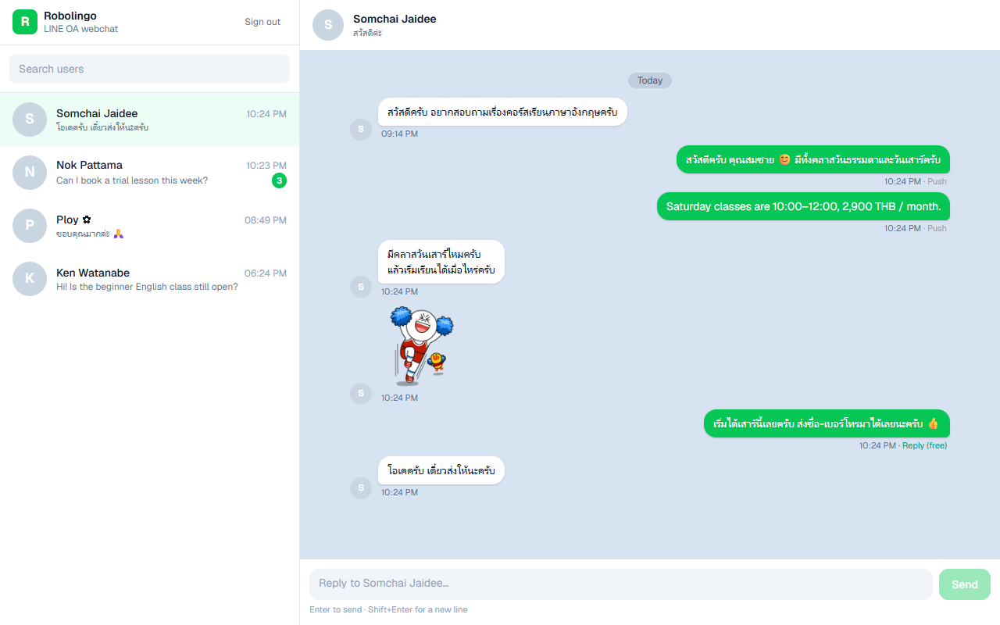
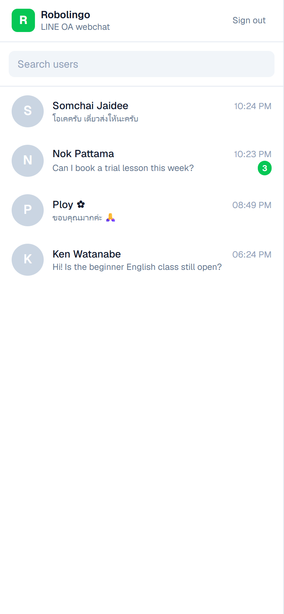
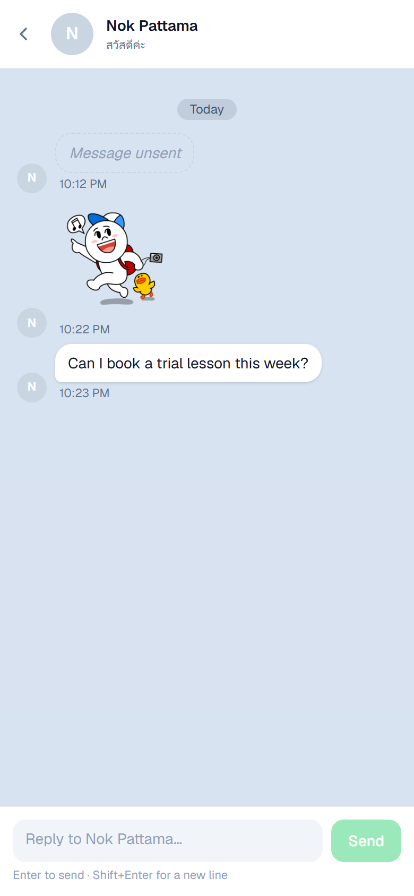
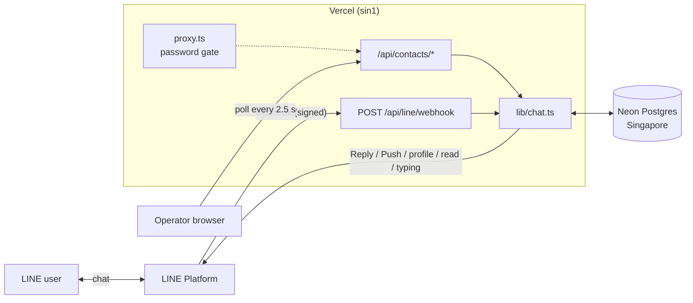
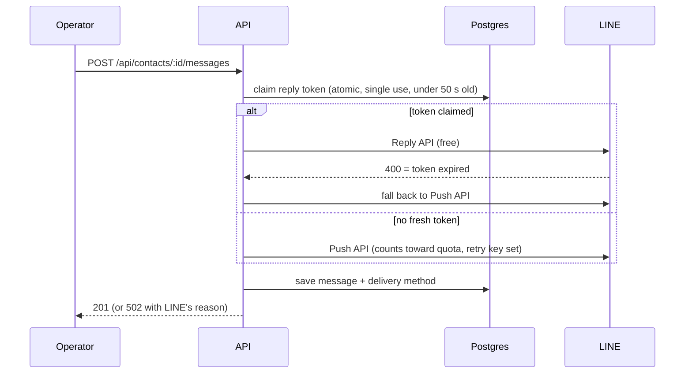

# Robolingo: LINE OA Webchat

[](https://github.com/ThisGameZR/robolingo/actions/workflows/ci.yml)

An operator inbox for a **LINE Official Account**. When LINE users message the OA, their messages show up here with each sender's LINE name and picture. An operator picks a user and replies, and the reply arrives in the user's LINE app as a message from the OA.

**Next.js 16 (App Router) · TypeScript · `@line/bot-sdk` · Drizzle ORM · Neon Postgres · Vercel**

| | |
| --- | --- |
| **Webchat** | https://robolingo-bice.vercel.app (the password is in the submission) |
| **LINE OA** | [Add @417avhgw as a friend](https://line.me/R/ti/p/@417avhgw), then send it a message |



<p>
  
  
</p>

## Features

**The brief**
- **Receive** messages sent to the OA (LINE webhook, signature-verified)
- **See who sent them**: LINE display name, profile picture, status, unread count, search
- **Pick a user and reply** from the webchat

**Beyond the brief**
- **Cost-aware delivery:** replies go out through the free **Reply API** when the user wrote within the last minute, and fall back to the **Push API** (which counts toward the monthly quota) otherwise. Every message shows which one was used. [ADR 0002](docs/adr/0002-reply-api-first.md)
- **Read receipts:** opening a conversation shows "Read" to the user in LINE
- **Typing indicator:** while the operator types, the user sees LINE's "..." animation
- **Unsend:** when a user unsends a message, its content is removed here too
- **Rich content:** stickers and images inline; video, audio, file and location
- **Send images and files:** use 📎 or paste a screenshot. Images are resized in the browser (which also strips GPS/EXIF data) and sent as real LINE image messages. Files go out as a download link, because LINE doesn't let an OA send files. [ADR 0006](docs/adr/0006-direct-uploads-to-blob.md)
- **Block detection:** shows when a user has blocked the OA
- **Reliable webhook:** idempotent processing, so LINE's retries are safe. [ADR 0003](docs/adr/0003-idempotent-webhook.md)
- **Security:** password gate, rate-limited login, strict security headers, and no LINE tokens ever sent to the browser
- **Mobile layout:** the user list and the chat take turns on small screens

## Architecture



### Sending a reply



### Code map

| Path | Responsibility |
| --- | --- |
| `src/app/api/line/webhook/route.ts` | Verifies the LINE signature on the raw body, then hands each event to `handleWebhookEvent` |
| `src/lib/chat.ts` | Domain logic: contacts, messages, delivery strategy, read receipts, unsend |
| `src/lib/line.ts` | LINE client and error helpers |
| `src/lib/auth.ts`, `src/proxy.ts` | Password gate (HMAC session cookie). The proxy redirects; each route also checks. |
| `src/lib/rate-limit.ts` | Postgres-backed fixed-window rate limiter |
| `src/app/api/uploads/route.ts`, `src/lib/media.ts` | Short-lived upload tokens for Vercel Blob, plus attachment rules (types, sizes, our-store-only URLs) |
| `src/lib/env.ts`, `src/instrumentation.ts` | Validated config; production refuses to boot when misconfigured |
| `src/components/Inbox.tsx` | The UI (client component, polling) |
| `src/db/schema.ts`, `drizzle/` | Schema and versioned SQL migrations |
| `test/` | Integration tests on a real Postgres engine (in-memory PGlite), with LINE mocked |

## Design decisions

The full reasoning is in [`docs/adr/`](docs/adr). In short:

| Decision | Why | Trade-off accepted |
| --- | --- | --- |
| [Polling, not WebSockets](docs/adr/0001-polling-over-websockets.md) | Vercel functions can't hold connections open, and polling needs no extra service | Up to ~2.5 s delay, plus some idle requests. A managed pub/sub service is the upgrade path. |
| [Reply API first, Push fallback](docs/adr/0002-reply-api-first.md) | Replies are free; push uses a quota of 300 messages a month on the free plan | Slightly more complex sending logic |
| [Idempotent webhook, retries allowed](docs/adr/0003-idempotent-webhook.md) | No message lost when the DB hiccups | Every handler must be safe to run twice. Tests enforce this. |
| [Postgres everywhere (Neon / PGlite)](docs/adr/0004-postgres-everywhere.md) | The same SQL runs in production, local dev and tests | PGlite cold start (~1 s) in dev and tests |
| [One shared password](docs/adr/0005-shared-password-gate.md) | It's enough for a single-team inbox and has nothing to manage | No per-operator audit trail yet |
| [Browser uploads directly to Blob](docs/adr/0006-direct-uploads-to-blob.md) | Vercel functions accept at most 4.5 MB per request; LINE allows 10 MB images | Uploaded files are public (unguessable URLs), because LINE must be able to fetch them |

### Correctness details worth knowing
- **Raw-body signature check:** the signature is computed over the exact bytes LINE sent, before any JSON parsing.
- **Duplicates:** LINE can redeliver webhooks. A unique `line_message_id` makes inserts no-ops on the second delivery.
- **Ordering:** a late or redelivered `follow` can't override a newer `unfollow` (guarded by event timestamp). An out-of-order message can't replace the latest preview.
- **Clock skew:** reply tokens are kept by *arrival* order. Comparing LINE's event time with our server's clock dropped fresh tokens, and a test now covers that case.
- **Single-use tokens under concurrency:** the reply token is claimed with one `UPDATE … FROM (SELECT … FOR UPDATE) RETURNING`. Two operators replying at once never both use it, and a test runs both at the same time.
- **No double sends:** after a Reply API **400** (token invalid), the message is sent again with Push. After an ambiguous failure (timeout or 5xx), it isn't resent, because it may already have been delivered.

## Security

- **Password gate:** HttpOnly, Secure, SameSite=Lax cookie containing an HMAC of the password, so changing the password signs everyone out. Comparisons take constant time. The app stays **locked** in production if `APP_PASSWORD` is missing.
- **Defense in depth:** `proxy.ts` redirects signed-out users, and every API route still checks the session itself.
- **Brute force:** at most 10 login attempts per IP per 15 minutes. The counters live in Postgres because serverless instances don't share memory.
- **Secrets stay server-side:** reply and read tokens are excluded from API responses (tested). The channel access token is only used server-side, including the image proxy.
- **Attachments:** upload tokens go only to signed-in operators, expire in 10 minutes, and are limited by type and size. The send API only accepts URLs from *our* Blob store under `uploads/`, so it can't be used to make the OA send arbitrary links (tested).
- **Headers:** CSP (`frame-ancestors 'none'`, images limited to our origin and LINE's CDN), HSTS, `nosniff`, `Referrer-Policy`, `Permissions-Policy`. No nonce, so pages can still be prerendered (see `next.config.ts`).
- **Configuration:** `zod`-validated environment. A malformed Channel secret or a missing key stops a production instance at start-up with a message saying what to fix.

## Testing

```bash
pnpm test        # 40 integration tests, about 3 s
```

The tests call the real route handlers and domain code against a real Postgres engine (PGlite running in memory, same migrations as production), with the LINE SDK mocked. They cover:
- signature rejection
- duplicate and out-of-order delivery
- retry safety
- Reply→Push fallback rules, including a concurrent token claim and clock skew
- read receipts and unsend
- token leakage
- auth, rate limiting and config validation

CI (GitHub Actions) runs typecheck, lint, tests and a production build on every push.

## Scaling path

The current design is sized for one OA and a small team. Here's what I'd change as load grows:

| When | Change |
| --- | --- |
| More operators online | Replace polling with pushed updates: Postgres `LISTEN/NOTIFY` → a pub/sub service (Ably, Pusher) or Server-Sent Events from a long-running service. Fetch messages incrementally (`?after=<id>`) instead of the last 200. |
| Webhook bursts | Acknowledge right away and process through a queue (Vercel Queues / QStash), keeping the same idempotent handlers |
| Several operators | Individual accounts (Auth.js / SSO), assigning conversations to operators, an audit log, roles |
| Several OAs | A `channel_id` on every row, per-channel secrets in a secret manager, and the webhook routed by `destination` |
| Data retention / PDPA | Retention policy for message content, export and delete per user, encryption at rest for content columns |
| Observability | Structured logs → log drain, error tracking, alerts on webhook 5xx rate and push quota |

## Run locally

Requires Node.js 20+ and pnpm.

```bash
pnpm install
cp .env.example .env.local   # LINE keys are optional just to open the UI
pnpm dev                     # http://localhost:3000
```

- **Database:** none needed. Without `DATABASE_URL`, an embedded Postgres (PGlite) is used, with migrations applied automatically. Delete `node_modules/.cache/robolingo-pglite` to reset it.
- **Login:** without `APP_PASSWORD`, the login screen is skipped in dev.
- **Real LINE messages locally:** LINE can't reach `localhost`. Expose port 3000 with a tunnel (`ngrok http 3000`) and use `<tunnel>/api/line/webhook` as the webhook URL.

| Script | |
| --- | --- |
| `pnpm test` / `pnpm test:watch` | Integration tests |
| `pnpm typecheck` / `pnpm lint` | Static checks |
| `pnpm db:generate` | Create a migration after editing `src/db/schema.ts` |
| `pnpm db:migrate` | Apply migrations to `DATABASE_URL` (Vercel runs this during the build) |

## Deploy (LINE + Vercel + Neon)

1. **LINE:**
   - Create an OA at [manager.line.biz](https://manager.line.biz) and enable the Messaging API.
   - In the [Developers Console](https://developers.line.biz/console/), copy the **Channel secret** and issue a **long-lived channel access token**.
   - In OA Manager → Response settings, turn **Webhooks on**, and turn **Auto-response** and **Greeting message off**.
2. **Vercel:**
   - Import the repo.
   - **Storage → Neon** sets `DATABASE_URL`. **Storage → Blob** (public) sets `BLOB_READ_WRITE_TOKEN` for attachments.
   - Add `LINE_CHANNEL_SECRET`, `LINE_CHANNEL_ACCESS_TOKEN` and `APP_PASSWORD`, then deploy. Migrations run in `vercel-build`.
   - `vercel.json` pins functions to `sin1`, next to the database.
3. **Webhook:**
   - Set `https://<app>.vercel.app/api/line/webhook`.
   - Click **Verify**, and turn **Use webhook** on.
   - Optionally turn **Webhook redelivery** on, so LINE retries failed deliveries.
4. **Deployment Protection:** keep it on for previews only, so LINE and users can reach production.

## Environment variables

| Name | Required | Description |
| --- | --- | --- |
| `LINE_CHANNEL_SECRET` | production | Verifies webhook signatures (32 hex characters) |
| `LINE_CHANNEL_ACCESS_TOKEN` | production | LINE API calls (reply, push, profile, content, read, typing) |
| `APP_PASSWORD` | production | Webchat password (8+ characters). Without it, the app stays locked. |
| `DATABASE_URL` | on Vercel | Neon Postgres. Local dev and tests use PGlite. |
| `BLOB_READ_WRITE_TOKEN` | for attachments | Vercel Blob store (set automatically when you connect a Blob store) |
| `LINE_API_BASE_URL` | no | Sends LINE API calls to a mock server (testing) |
